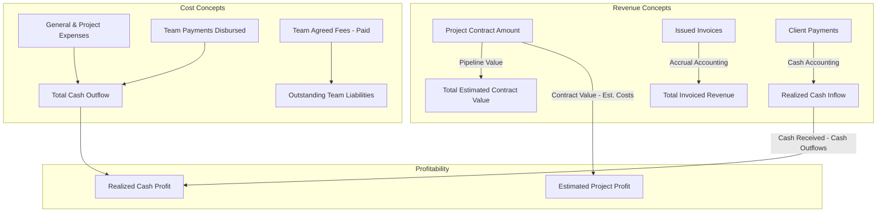
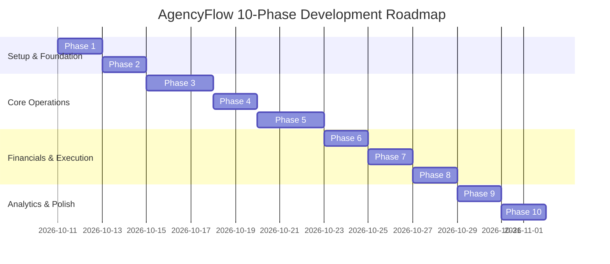

# AgencyFlow — Production Implementation Plan & Architecture Specification

**System:** AgencyFlow — Enterprise Web Agency Management System  
**Stack:** Next.js (App Router, TypeScript) + Tailwind CSS + shadcn/ui + Supabase (PostgreSQL, Auth, Storage, RLS) + Recharts + React Hook Form + Zod + @react-pdf/renderer  
**Target Environment:** Agency Internal Operations (Base Currency: LKR, Multi-Currency Support)  
**Version:** 1.0.0-draft  
**Date:** 2026-10-10  

---

## 1. System Overview & Architectural Analysis

### 1.1 Core Objectives
AgencyFlow is a dedicated agency operations operating system designed to run end-to-end web design and development operations. Unlike generic CRMs, AgencyFlow integrates project lifecycles directly with domain/hosting asset management, milestone tracking, client invoicing, contractor assignments, and strict financial accounting.

### 1.2 Missing Relationships & Identified Edge Cases

During architectural analysis, the following structural complexities and edge cases were identified and solved:

1. **The Double-Counting Hazard in Agency Finances:**
   - *Problem:* Invoicing a client for LKR 500,000 does not equal LKR 500,000 cash in the bank. If invoices and client payments are both summed as "Income", revenue is doubled.
   - *Solution:* Strict dual-metric ledger model:
     - **Accrual / Invoiced Revenue:** Sum of finalized, non-void invoices.
     - **Cash Flow / Realized Revenue:** Sum of actual verified `client_payments`.
     - **Contracted Pipeline:** Sum of `projects.contract_amount` where status is not cancelled.
2. **Team Payments vs. Business Expenses:**
   - *Problem:* If a project manager records a payout of LKR 25,000 to a freelance developer under `team_payments`, and an accountant also records a "Freelancer payment" in `expenses`, the expense is counted twice.
   - *Solution:* `team_payments` is the authoritative source for contractor disbursements. When an expense summary is computed, queries execute a unified calculation:
     $$\text{Total Expenses} = \sum(\text{expenses}) + \sum(\text{team\_payments})$$
     General business expenses explicitly exclude team assignment payouts (enforced via foreign key constraint `team_payment_id` linking expense or by treating `team_payments` as a first-class expense sub-ledger).
3. **Multi-Currency Transactions vs. Base Currency (LKR):**
   - *Problem:* An agency operates in Sri Lanka (LKR) but bills US clients in USD ($1,500) and European clients in EUR (€1,200). Summing raw numbers results in corrupted financials.
   - *Solution:* Every invoice, payment, and expense stores `currency`, `original_amount`, and `exchange_rate_to_base`, plus `base_amount` (LKR). All reports, dashboard KPIs, and profit metrics compute strictly on `base_amount`.
4. **Invoice Freezing & Immutable Tax Snapshots:**
   - *Problem:* If an agency updates its legal address or VAT registration number in settings, previously issued historical invoices must not retroactively mutate.
   - *Solution:* An invoice row stores immutable JSONB snapshots: `issuer_snapshot` (agency legal details at time of issue) and `client_snapshot` (client billing address and tax ID at time of issue). Once status transitions to `sent`, `partially_paid`, or `paid`, these snapshots are locked.
5. **Partial Payments, Overpayments & Credit Balances:**
   - *Problem:* Clients often pay deposits or lump sums spanning multiple invoices or milestones.
   - *Solution:* Separate `client_payments` from `invoice_payment_allocations`. A payment can be allocated across one or more invoices atomically using database transactions. Overpayments remain as unallocated client credit.
6. **Sequential Human-Readable IDs with Race-Condition Safety:**
   - *Problem:* Simple `COUNT(*) + 1` leads to duplicate invoice numbers under concurrent operations.
   - *Solution:* PostgreSQL atomic sequence generator with locking table or `SERIAL`/`SEQUENCE` per agency fiscal year (e.g., `AF-INV-2026-0001`, `AF-PRJ-0042`).
7. **Hosting & Domain Renewal Traps:**
   - *Problem:* Domains or hosting expire without notice, or the agency pays for renewals that were client liabilities, causing cash leaks.
   - *Solution:* Dedicated `renewal_ownership` flag (`agency_managed_billed_to_client`, `agency_absorbed_in_retainer`, `client_direct`). Automated alerts at 30, 14, and 7-day windows with automated draft invoice line generation.

---

## 2. Authentication & Authorization Strategy

### 2.1 Role Hierarchy & Permissions Matrix

The system enforces three distinct roles:
1. **Super Admin (Agency Owner):** Full system access. Access to company profitability, net margins, bank configurations, team payment rates, and tax parameters.
2. **Admin / Project Manager:** Can create/edit clients, projects, tasks, milestones, hosting/domains, and draft invoices. **Restricted from:** viewing agency-wide profit margins, other team members' salary/payout rates, and core banking settings.
3. **Team Member (Developer / Designer / Freelancer):** Can view only projects they are assigned to, update tasks assigned to them, and view their *own* payment ledger and milestones. Cannot view client billing details, invoices, agency expenses, or other members' earnings.

| Feature / Resource | Super Admin (Owner) | Admin / PM | Team Member |
| :--- | :---: | :---: | :---: |
| Executive Financial Dashboard | Full | Restricted (No Profits/Margins) | None |
| Client Management | Full | Full | View Only (Assigned) |
| Project Management | Full | Full | View Assigned Only |
| Task & Milestone Management | Full | Full | Update Assigned Tasks |
| Domain & Hosting Management | Full | Full | View Assigned Only |
| Invoice Creation & Issuance | Full | Full (Draft/Send) | None |
| Financial Transactions & Ledger | Full | None | None |
| Team Payment Obligations & Payouts | Full | View Project Scope (No Global Rates) | View Own Payouts Only |
| Reports & Exports (P&L, Margins) | Full | Operational Reports Only | None |
| Agency Settings & Bank Accounts | Full | None | None |

### 2.2 Security Implementation in Next.js & Supabase
- **Row Level Security (RLS):** Every table has `ALTER TABLE ... ENABLE ROW LEVEL SECURITY;`.
- **User Identity & Role Link:** `auth.users.id` maps 1:1 to `public.profiles.id`. Profile contains `role` (`super_admin`, `admin`, `team_member`) and `is_active`.
- **Database Helper Functions:**
  - `auth.user_role() RETURNS text`: securely retrieves calling user's role with `SECURITY DEFINER`.
  - `auth.is_super_admin() RETURNS boolean`
  - `auth.is_project_member(project_id uuid) RETURNS boolean`
- **Application Layer Protection:**
  - Next.js Edge Middleware for route protection (`/dashboard/finances` redirects unauthorized roles).
  - Server Actions validate user session and role via Supabase Server Client before executing mutations.

---

## 3. Database Architecture (Supabase PostgreSQL Schema)

```sql
-- ============================================================================
-- EXTENSIONS & ENUMS
-- ============================================================================
CREATE EXTENSION IF NOT EXISTS "uuid-ossp";

CREATE TYPE user_role AS ENUM ('super_admin', 'admin', 'team_member');
CREATE TYPE client_status AS ENUM ('active', 'inactive', 'lead', 'archived');
CREATE TYPE project_status AS ENUM ('lead', 'planning', 'in_progress', 'review', 'completed', 'on_hold', 'cancelled');
CREATE TYPE project_priority AS ENUM ('low', 'medium', 'high', 'urgent');
CREATE TYPE task_status AS ENUM ('backlog', 'todo', 'in_progress', 'in_review', 'done');
CREATE TYPE task_priority AS ENUM ('low', 'medium', 'high', 'urgent');
CREATE TYPE domain_status AS ENUM ('active', 'pending_transfer', 'expired', 'cancelled');
CREATE TYPE hosting_status AS ENUM ('active', 'suspended', 'expired', 'cancelled');
CREATE TYPE renewal_ownership AS ENUM ('agency_billed', 'agency_absorbed', 'client_direct');
CREATE TYPE invoice_status AS ENUM ('draft', 'sent', 'partially_paid', 'paid', 'overdue', 'void');
CREATE TYPE payment_method AS ENUM ('bank_transfer', 'credit_card', 'cash', 'cheque', 'wise', 'payoneer', 'other');
CREATE TYPE employment_type AS ENUM ('full_time', 'part_time', 'contractor', 'freelancer');
CREATE TYPE payment_basis AS ENUM ('fixed_project', 'hourly', 'monthly_retainer', 'milestone');
CREATE TYPE assignment_payment_status AS ENUM ('unpaid', 'partially_paid', 'paid');
CREATE TYPE expense_type AS ENUM ('project_specific', 'general_operational');

-- ============================================================================
-- 1. PROFILES & ROLES
-- ============================================================================
CREATE TABLE profiles (
    id UUID PRIMARY KEY REFERENCES auth.users(id) ON DELETE CASCADE,
    email TEXT NOT NULL UNIQUE,
    full_name TEXT NOT NULL,
    avatar_url TEXT,
    phone TEXT,
    role user_role NOT NULL DEFAULT 'team_member',
    is_active BOOLEAN NOT NULL DEFAULT true,
    created_at TIMESTAMPTZ NOT NULL DEFAULT now(),
    updated_at TIMESTAMPTZ NOT NULL DEFAULT now()
);

-- ============================================================================
-- 2. AGENCY SETTINGS
-- ============================================================================
CREATE TABLE agency_settings (
    id UUID PRIMARY KEY DEFAULT uuid_generate_v4(),
    agency_name TEXT NOT NULL DEFAULT 'AgencyFlow',
    legal_name TEXT,
    tagline TEXT,
    logo_url TEXT,
    website TEXT,
    email TEXT NOT NULL,
    phone TEXT,
    address_line1 TEXT,
    address_line2 TEXT,
    city TEXT,
    state TEXT,
    postal_code TEXT,
    country TEXT NOT NULL DEFAULT 'Sri Lanka',
    base_currency VARCHAR(3) NOT NULL DEFAULT 'LKR',
    tax_identifier TEXT,
    default_tax_rate NUMERIC(5,2) DEFAULT 0.00,
    invoice_prefix TEXT NOT NULL DEFAULT 'AF-INV-',
    invoice_next_number INT NOT NULL DEFAULT 1001,
    invoice_footer_notes TEXT,
    bank_name TEXT,
    bank_account_name TEXT,
    bank_account_number TEXT,
    bank_branch_code TEXT,
    bank_swift_code TEXT,
    updated_at TIMESTAMPTZ NOT NULL DEFAULT now()
);

-- ============================================================================
-- 3. CLIENT MANAGEMENT
-- ============================================================================
CREATE TABLE clients (
    id UUID PRIMARY KEY DEFAULT uuid_generate_v4(),
    client_code TEXT NOT NULL UNIQUE, -- e.g. CLT-1001
    name TEXT NOT NULL,
    company_name TEXT,
    contact_person TEXT,
    email TEXT NOT NULL,
    phone TEXT,
    whatsapp TEXT,
    address TEXT,
    city TEXT,
    country TEXT NOT NULL DEFAULT 'Sri Lanka',
    currency VARCHAR(3) NOT NULL DEFAULT 'LKR',
    tax_number TEXT,
    status client_status NOT NULL DEFAULT 'active',
    notes TEXT,
    created_at TIMESTAMPTZ NOT NULL DEFAULT now(),
    updated_at TIMESTAMPTZ NOT NULL DEFAULT now()
);

-- ============================================================================
-- 4. PROJECT MANAGEMENT
-- ============================================================================
CREATE TABLE projects (
    id UUID PRIMARY KEY DEFAULT uuid_generate_v4(),
    project_code TEXT NOT NULL UNIQUE, -- e.g. PRJ-2026-001
    client_id UUID NOT NULL REFERENCES clients(id) ON DELETE RESTRICT,
    name TEXT NOT NULL,
    description TEXT,
    category TEXT, -- e.g. E-Commerce, Corporate Web, Custom SaaS
    technologies TEXT[], -- ['Next.js', 'PostgreSQL', 'Tailwind']
    status project_status NOT NULL DEFAULT 'planning',
    priority project_priority NOT NULL DEFAULT 'medium',
    start_date DATE,
    expected_delivery_date DATE,
    actual_completion_date DATE,
    currency VARCHAR(3) NOT NULL DEFAULT 'LKR',
    contract_amount NUMERIC(14,2) NOT NULL DEFAULT 0.00,
    estimated_costs NUMERIC(14,2) NOT NULL DEFAULT 0.00,
    project_manager_id UUID REFERENCES profiles(id) ON DELETE SET NULL,
    notes TEXT,
    created_at TIMESTAMPTZ NOT NULL DEFAULT now(),
    updated_at TIMESTAMPTZ NOT NULL DEFAULT now()
);

-- ============================================================================
-- 5. TEAM & ASSIGNMENTS (Payroll & Obligations)
-- ============================================================================
CREATE TABLE team_members (
    id UUID PRIMARY KEY DEFAULT uuid_generate_v4(),
    profile_id UUID REFERENCES profiles(id) ON DELETE SET NULL,
    full_name TEXT NOT NULL,
    email TEXT NOT NULL,
    phone TEXT,
    designation TEXT NOT NULL, -- e.g. Senior Frontend Engineer
    skills TEXT[],
    employment_type employment_type NOT NULL DEFAULT 'contractor',
    default_payment_basis payment_basis NOT NULL DEFAULT 'fixed_project',
    default_rate NUMERIC(12,2) DEFAULT 0.00,
    currency VARCHAR(3) NOT NULL DEFAULT 'LKR',
    status TEXT NOT NULL DEFAULT 'active',
    bank_account_details TEXT,
    notes TEXT,
    created_at TIMESTAMPTZ NOT NULL DEFAULT now(),
    updated_at TIMESTAMPTZ NOT NULL DEFAULT now()
);

CREATE TABLE project_assignments (
    id UUID PRIMARY KEY DEFAULT uuid_generate_v4(),
    project_id UUID NOT NULL REFERENCES projects(id) ON DELETE CASCADE,
    team_member_id UUID NOT NULL REFERENCES team_members(id) ON DELETE RESTRICT,
    role_in_project TEXT NOT NULL, -- Lead Developer, UI Designer, QA
    agreed_fee NUMERIC(14,2) NOT NULL DEFAULT 0.00,
    currency VARCHAR(3) NOT NULL DEFAULT 'LKR',
    payment_status assignment_payment_status NOT NULL DEFAULT 'unpaid',
    notes TEXT,
    created_at TIMESTAMPTZ NOT NULL DEFAULT now(),
    updated_at TIMESTAMPTZ NOT NULL DEFAULT now(),
    UNIQUE(project_id, team_member_id)
);

CREATE TABLE team_payments (
    id UUID PRIMARY KEY DEFAULT uuid_generate_v4(),
    payment_code TEXT NOT NULL UNIQUE, -- e.g. TP-2026-0001
    team_member_id UUID NOT NULL REFERENCES team_members(id) ON DELETE RESTRICT,
    project_assignment_id UUID REFERENCES project_assignments(id) ON DELETE SET NULL,
    project_id UUID REFERENCES projects(id) ON DELETE SET NULL,
    amount NUMERIC(14,2) NOT NULL CHECK (amount > 0),
    currency VARCHAR(3) NOT NULL DEFAULT 'LKR',
    exchange_rate_to_base NUMERIC(10,4) NOT NULL DEFAULT 1.0000,
    base_amount NUMERIC(14,2) NOT NULL, -- amount * exchange_rate
    payment_date DATE NOT NULL DEFAULT CURRENT_DATE,
    payment_method payment_method NOT NULL DEFAULT 'bank_transfer',
    reference_number TEXT,
    receipt_url TEXT,
    notes TEXT,
    created_by UUID REFERENCES profiles(id),
    created_at TIMESTAMPTZ NOT NULL DEFAULT now()
);

-- ============================================================================
-- 6. DOMAINS, HOSTING & RENEWALS
-- ============================================================================
CREATE TABLE domains (
    id UUID PRIMARY KEY DEFAULT uuid_generate_v4(),
    project_id UUID NOT NULL REFERENCES projects(id) ON DELETE CASCADE,
    client_id UUID NOT NULL REFERENCES clients(id) ON DELETE CASCADE,
    domain_name TEXT NOT NULL,
    registrar TEXT NOT NULL,
    registration_date DATE,
    expiration_date DATE NOT NULL,
    renewal_cost NUMERIC(10,2) NOT NULL DEFAULT 0.00,
    currency VARCHAR(3) NOT NULL DEFAULT 'LKR',
    auto_renew BOOLEAN NOT NULL DEFAULT false,
    renewal_ownership renewal_ownership NOT NULL DEFAULT 'agency_billed',
    status domain_status NOT NULL DEFAULT 'active',
    dns_records_notes TEXT,
    created_at TIMESTAMPTZ NOT NULL DEFAULT now(),
    updated_at TIMESTAMPTZ NOT NULL DEFAULT now()
);

CREATE TABLE hosting_services (
    id UUID PRIMARY KEY DEFAULT uuid_generate_v4(),
    project_id UUID NOT NULL REFERENCES projects(id) ON DELETE CASCADE,
    client_id UUID NOT NULL REFERENCES clients(id) ON DELETE CASCADE,
    provider TEXT NOT NULL, -- e.g. AWS, Vercel, DigitalOcean, Hetzner
    plan_name TEXT NOT NULL,
    server_reference TEXT, -- server IP or identifier (no secrets!)
    start_date DATE,
    expiration_date DATE NOT NULL,
    renewal_cost NUMERIC(10,2) NOT NULL DEFAULT 0.00,
    currency VARCHAR(3) NOT NULL DEFAULT 'LKR',
    billing_cycle TEXT NOT NULL DEFAULT 'yearly', -- monthly, yearly
    renewal_ownership renewal_ownership NOT NULL DEFAULT 'agency_billed',
    status hosting_status NOT NULL DEFAULT 'active',
    notes TEXT,
    created_at TIMESTAMPTZ NOT NULL DEFAULT now(),
    updated_at TIMESTAMPTZ NOT NULL DEFAULT now()
);

-- ============================================================================
-- 7. INVOICING & CLIENT PAYMENTS
-- ============================================================================
CREATE TABLE invoices (
    id UUID PRIMARY KEY DEFAULT uuid_generate_v4(),
    invoice_number TEXT NOT NULL UNIQUE, -- e.g. AF-INV-2026-1001
    client_id UUID NOT NULL REFERENCES clients(id) ON DELETE RESTRICT,
    project_id UUID REFERENCES projects(id) ON DELETE SET NULL,
    issue_date DATE NOT NULL DEFAULT CURRENT_DATE,
    due_date DATE NOT NULL,
    currency VARCHAR(3) NOT NULL DEFAULT 'LKR',
    exchange_rate_to_base NUMERIC(10,4) NOT NULL DEFAULT 1.0000,
    subtotal NUMERIC(14,2) NOT NULL DEFAULT 0.00,
    tax_rate NUMERIC(5,2) NOT NULL DEFAULT 0.00,
    tax_amount NUMERIC(14,2) NOT NULL DEFAULT 0.00,
    discount_amount NUMERIC(14,2) NOT NULL DEFAULT 0.00,
    total_amount NUMERIC(14,2) NOT NULL DEFAULT 0.00,
    base_total_amount NUMERIC(14,2) NOT NULL DEFAULT 0.00,
    amount_paid NUMERIC(14,2) NOT NULL DEFAULT 0.00,
    balance_due NUMERIC(14,2) NOT NULL DEFAULT 0.00,
    status invoice_status NOT NULL DEFAULT 'draft',
    notes TEXT,
    payment_terms TEXT,
    issuer_snapshot JSONB, -- Static capture of agency profile at issuance
    client_snapshot JSONB, -- Static capture of client address/tax ID at issuance
    pdf_url TEXT,
    created_by UUID REFERENCES profiles(id),
    created_at TIMESTAMPTZ NOT NULL DEFAULT now(),
    updated_at TIMESTAMPTZ NOT NULL DEFAULT now()
);

CREATE TABLE invoice_items (
    id UUID PRIMARY KEY DEFAULT uuid_generate_v4(),
    invoice_id UUID NOT NULL REFERENCES invoices(id) ON DELETE CASCADE,
    item_order INT NOT NULL DEFAULT 1,
    description TEXT NOT NULL,
    service_category TEXT NOT NULL, -- 'web_dev', 'design', 'hosting', 'domain', 'maintenance', 'seo'
    quantity NUMERIC(8,2) NOT NULL DEFAULT 1.00,
    unit_price NUMERIC(14,2) NOT NULL DEFAULT 0.00,
    total_price NUMERIC(14,2) NOT NULL DEFAULT 0.00,
    created_at TIMESTAMPTZ NOT NULL DEFAULT now()
);

CREATE TABLE client_payments (
    id UUID PRIMARY KEY DEFAULT uuid_generate_v4(),
    payment_code TEXT NOT NULL UNIQUE, -- e.g. REC-2026-0001
    client_id UUID NOT NULL REFERENCES clients(id) ON DELETE RESTRICT,
    project_id UUID REFERENCES projects(id) ON DELETE SET NULL,
    amount NUMERIC(14,2) NOT NULL CHECK (amount > 0),
    currency VARCHAR(3) NOT NULL DEFAULT 'LKR',
    exchange_rate_to_base NUMERIC(10,4) NOT NULL DEFAULT 1.0000,
    base_amount NUMERIC(14,2) NOT NULL,
    payment_date DATE NOT NULL DEFAULT CURRENT_DATE,
    payment_method payment_method NOT NULL DEFAULT 'bank_transfer',
    reference_number TEXT,
    receipt_url TEXT,
    notes TEXT,
    created_by UUID REFERENCES profiles(id),
    created_at TIMESTAMPTZ NOT NULL DEFAULT now()
);

CREATE TABLE invoice_payment_allocations (
    id UUID PRIMARY KEY DEFAULT uuid_generate_v4(),
    invoice_id UUID NOT NULL REFERENCES invoices(id) ON DELETE RESTRICT,
    client_payment_id UUID NOT NULL REFERENCES client_payments(id) ON DELETE CASCADE,
    allocated_amount NUMERIC(14,2) NOT NULL CHECK (allocated_amount > 0),
    created_at TIMESTAMPTZ NOT NULL DEFAULT now(),
    UNIQUE(invoice_id, client_payment_id)
);

-- ============================================================================
-- 8. EXPENSES (Excluding Team Payments to Prevent Double Counting)
-- ============================================================================
CREATE TABLE expense_categories (
    id UUID PRIMARY KEY DEFAULT uuid_generate_v4(),
    name TEXT NOT NULL UNIQUE,
    description TEXT,
    is_active BOOLEAN NOT NULL DEFAULT true
);

CREATE TABLE expenses (
    id UUID PRIMARY KEY DEFAULT uuid_generate_v4(),
    expense_code TEXT NOT NULL UNIQUE, -- e.g. EXP-2026-0001
    category_id UUID NOT NULL REFERENCES expense_categories(id) ON DELETE RESTRICT,
    project_id UUID REFERENCES projects(id) ON DELETE SET NULL,
    expense_type expense_type NOT NULL DEFAULT 'general_operational',
    title TEXT NOT NULL,
    description TEXT,
    amount NUMERIC(14,2) NOT NULL CHECK (amount > 0),
    currency VARCHAR(3) NOT NULL DEFAULT 'LKR',
    exchange_rate_to_base NUMERIC(10,4) NOT NULL DEFAULT 1.0000,
    base_amount NUMERIC(14,2) NOT NULL,
    expense_date DATE NOT NULL DEFAULT CURRENT_DATE,
    payment_method payment_method NOT NULL DEFAULT 'bank_transfer',
    receipt_url TEXT,
    vendor_name TEXT,
    is_recurring BOOLEAN NOT NULL DEFAULT false,
    recurring_period TEXT, -- 'monthly', 'yearly'
    created_by UUID REFERENCES profiles(id),
    created_at TIMESTAMPTZ NOT NULL DEFAULT now(),
    updated_at TIMESTAMPTZ NOT NULL DEFAULT now()
);

-- ============================================================================
-- 9. TASKS, MILESTONES & ACTIVITIES
-- ============================================================================
CREATE TABLE project_milestones (
    id UUID PRIMARY KEY DEFAULT uuid_generate_v4(),
    project_id UUID NOT NULL REFERENCES projects(id) ON DELETE CASCADE,
    title TEXT NOT NULL,
    description TEXT,
    target_date DATE NOT NULL,
    completion_date DATE,
    order_index INT NOT NULL DEFAULT 1,
    is_completed BOOLEAN NOT NULL DEFAULT false,
    created_at TIMESTAMPTZ NOT NULL DEFAULT now()
);

CREATE TABLE project_tasks (
    id UUID PRIMARY KEY DEFAULT uuid_generate_v4(),
    project_id UUID NOT NULL REFERENCES projects(id) ON DELETE CASCADE,
    milestone_id UUID REFERENCES project_milestones(id) ON DELETE SET NULL,
    title TEXT NOT NULL,
    description TEXT,
    status task_status NOT NULL DEFAULT 'todo',
    priority task_priority NOT NULL DEFAULT 'medium',
    assigned_to UUID REFERENCES profiles(id) ON DELETE SET NULL,
    due_date DATE,
    order_index INT NOT NULL DEFAULT 0,
    created_at TIMESTAMPTZ NOT NULL DEFAULT now(),
    updated_at TIMESTAMPTZ NOT NULL DEFAULT now()
);

CREATE TABLE activity_logs (
    id UUID PRIMARY KEY DEFAULT uuid_generate_v4(),
    user_id UUID REFERENCES profiles(id) ON DELETE SET NULL,
    entity_type TEXT NOT NULL, -- 'project', 'client', 'invoice', 'payment', 'team'
    entity_id UUID NOT NULL,
    action TEXT NOT NULL, -- 'created', 'updated', 'status_changed', 'payment_recorded'
    details JSONB,
    created_at TIMESTAMPTZ NOT NULL DEFAULT now()
);
```

---

## 4. Financial Calculation Engine & Double-Counting Prevention

To ensure financial accuracy without discrepancies, the system enforces unambiguous formulas:



### 4.1 Strict Mathematical Formulations

1. **Total Contracted Pipeline Value:**
   $$\sum_{p \in \text{Projects } (\text{status} \neq \text{'cancelled'})} p.\text{contract\_amount}$$
2. **Invoiced Revenue (Accrual):**
   $$\sum_{i \in \text{Invoices } (\text{status} \neq \text{'draft', 'void'})} i.\text{base\_total\_amount}$$
3. **Realized Cash Revenue (Inflow):**
   $$\sum_{cp \in \text{Client Payments}} cp.\text{base\_amount}$$
4. **Client Accounts Receivable (Outstanding Balance):**
   $$\sum_{i \in \text{Invoices } (\text{status} \in \{\text{'sent', 'partially\_paid', 'overdue'}\})} i.\text{balance\_due}$$
5. **Total Business Expenses (Outflow):**
   $$\text{Total Outflow} = \sum_{e \in \text{Expenses}} e.\text{base\_amount} + \sum_{tp \in \text{Team Payments}} tp.\text{base\_amount}$$
   *(Note: Team payments are never stored in the `expenses` table. They are summed dynamically to prevent duplicate entries).*
6. **Outstanding Team Liabilities (Payable):**
   $$\text{Team Liabilities} = \sum_{pa \in \text{Project Assignments}} pa.\text{agreed\_fee} - \sum_{tp \in \text{Team Payments}} tp.\text{amount}$$
7. **Realized Net Profit:**
   $$\text{Realized Net Profit} = \text{Realized Cash Revenue} - \text{Total Business Expenses}$$
8. **Per-Project Profit Margin:**
   $$\text{Project Margin (\%)} = \frac{\text{Project Invoiced or Received} - (\text{Direct Expenses} + \text{Team Payouts})}{\text{Project Invoiced or Received}} \times 100$$

---

## 5. Directory & File Structure (Next.js App Router)

```
c:/project/managemnt/
├── .env.example
├── .env.local
├── .eslintrc.json
├── .gitignore
├── next.config.ts
├── package.json
├── postcss.config.mjs
├── tailwind.config.ts
├── tsconfig.json
├── supabase/
│   ├── migrations/
│   │   ├── 20261010000001_initial_schema.sql
│   │   ├── 20261010000002_rls_policies.sql
│   │   └── 20261010000003_seed_data.sql
│   └── seed.sql
├── src/
│   ├── app/
│   │   ├── layout.tsx
│   │   ├── page.tsx
│   │   ├── (auth)/
│   │   │   ├── login/page.tsx
│   │   │   └── forgot-password/page.tsx
│   │   └── (dashboard)/
│   │       ├── layout.tsx
│   │       ├── dashboard/page.tsx
│   │       ├── clients/
│   │       │   ├── page.tsx
│   │       │   ├── [id]/page.tsx
│   │       │   └── new/page.tsx
│   │       ├── projects/
│   │       │   ├── page.tsx
│   │       │   ├── [id]/
│   │       │   │   ├── page.tsx
│   │       │   │   ├── tasks/page.tsx
│   │       │   │   ├── team/page.tsx
│   │       │   │   ├── domains/page.tsx
│   │       │   │   ├── invoices/page.tsx
│   │       │   │   ├── finances/page.tsx
│   │       │   │   └── files/page.tsx
│   │       │   └── new/page.tsx
│   │       ├── domains-hosting/
│   │       │   ├── page.tsx
│   │       │   └── renewals/page.tsx
│   │       ├── invoices/
│   │       │   ├── page.tsx
│   │       │   ├── [id]/page.tsx
│   │       │   ├── [id]/preview/page.tsx
│   │       │   └── new/page.tsx
│   │       ├── finances/
│   │       │   ├── page.tsx
│   │       │   ├── income/page.tsx
│   │       │   ├── expenses/page.tsx
│   │       │   └── transactions/page.tsx
│   │       ├── team/
│   │       │   ├── page.tsx
│   │       │   ├── [id]/page.tsx
│   │       │   └── payments/page.tsx
│   │       ├── renewals/page.tsx
│   │       ├── reports/
│   │       │   ├── page.tsx
│   │       │   ├── monthly/page.tsx
│   │       │   ├── profit-loss/page.tsx
│   │       │   └── project-margins/page.tsx
│   │       └── settings/
│   │           ├── page.tsx
│   │           ├── agency/page.tsx
│   │           ├── team-roles/page.tsx
│   │           └── bank-details/page.tsx
│   ├── components/
│   │   ├── ui/                    # shadcn/ui components (button, card, dialog, table, etc.)
│   │   ├── layout/
│   │   │   ├── sidebar.tsx
│   │   │   ├── topbar.tsx
│   │   │   ├── user-nav.tsx
│   │   │   └── mobile-nav.tsx
│   │   ├── dashboard/
│   │   │   ├── stat-card.tsx
│   │   │   ├── revenue-expense-chart.tsx
│   │   │   ├── project-status-chart.tsx
│   │   │   ├── upcoming-renewals-card.tsx
│   │   │   └── recent-activity-list.tsx
│   │   ├── clients/
│   │   │   ├── client-table.tsx
│   │   │   ├── client-form.tsx
│   │   │   └── client-detail-tabs.tsx
│   │   ├── projects/
│   │   │   ├── project-card.tsx
│   │   │   ├── project-table.tsx
│   │   │   ├── project-form.tsx
│   │   │   ├── project-profit-summary.tsx
│   │   │   └── kanban-board.tsx
│   │   ├── invoices/
│   │   │   ├── invoice-builder.tsx
│   │   │   ├── invoice-line-items.tsx
│   │   │   ├── invoice-pdf-document.tsx
│   │   │   └── record-payment-dialog.tsx
│   │   ├── finances/
│   │   │   ├── expense-form.tsx
│   │   │   ├── income-form.tsx
│   │   │   └── cashflow-breakdown.tsx
│   │   └── team/
│   │       ├── team-payment-modal.tsx
│   │       ├── assignment-calculator.tsx
│   │       └── team-ledger-table.tsx
│   ├── lib/
│   │   ├── supabase/
│   │   │   ├── client.ts         # Browser Supabase client
│   │   │   ├── server.ts         # Server Component / Action client with cookies
│   │   │   └── middleware.ts     # Session refresh & route guards
│   │   ├── calculations/
│   │   │   ├── finance.ts        # Decimal math for invoices, taxes, profit
│   │   │   └── currency.ts       # Currency conversion utilities
│   │   ├── validations/
│   │   │   ├── client.schema.ts
│   │   │   ├── project.schema.ts
│   │   │   ├── invoice.schema.ts
│   │   │   ├── expense.schema.ts
│   │   │   └── team.schema.ts
│   │   └── utils.ts
│   └── actions/                  # Next.js Server Actions with role validation
│       ├── clients.actions.ts
│       ├── projects.actions.ts
│       ├── invoices.actions.ts
│       ├── finances.actions.ts
│       ├── team.actions.ts
│       ├── domains.actions.ts
│       └── settings.actions.ts
```

---

## 6. Dashboard Layout & Navigation Architecture

- **Visual Style:** SaaS aesthetic, clean borders (`border-slate-200 dark:border-slate-800`), neutral slate backgrounds with subtle zinc/indigo accents, crisp typography (Inter/Outfit), fluid transitions.
- **Sidebar (Collapsible):**
  - Brand header: AgencyFlow Logo + Active Workspace Badge
  - Navigation Sections:
    - **Overview:** Dashboard
    - **Operations:** Clients, Projects, Tasks & Milestones
    - **Assets & Renewals:** Domains & Hosting, Renewal Reminders
    - **Invoicing & Billing:** Invoices, Payment Records
    - **Financials (Role-Restricted):** Cash Flow, Expenses, Profitability
    - **Team & Payroll:** Team Members, Project Assignments, Team Payments
    - **Intelligence:** Reports & Analytics, Export Center
    - **System:** Agency Settings
- **Sticky Top Bar:**
  - Quick Search (Command Palette `Cmd+K` for rapid client/project search)
  - Date Range Global Selector
  - Urgent Renewal Pill (e.g., `3 domains expiring soon`)
  - Notifications Bell (slide-over drawer)
  - Dark/Light Theme Toggle
  - User Avatar with Role badge and dropdown menu

---

## 7. Ten-Phase Detailed Implementation Plan



---

### Phase 1: Project Setup, Architecture, UI Design System, Authentication
- **Objective:** Establish the production Next.js 15+ App Router baseline, Tailwind CSS, shadcn/ui components, Supabase client authentication, role-based layout shells, and theme engine.
- **Features:**
  - Initialize project with strict TypeScript and modern Next.js configuration.
  - Setup shadcn/ui component library with cohesive styling, subtle shadows, and slate/indigo theme tokens.
  - Implement Supabase Auth (Email + Password) with secure cookie management (`@supabase/ssr`).
  - Build persistent dashboard layout (Sidebar, Topbar, User profile dropdown, Theme toggle).
  - Implement Edge Middleware to gate authenticated routes and verify session validity.
- **Pages to Create:**
  - `src/app/(auth)/login/page.tsx`
  - `src/app/(auth)/forgot-password/page.tsx`
  - `src/app/(dashboard)/layout.tsx`
  - `src/app/(dashboard)/dashboard/page.tsx` (Skeleton shell)
- **Components to Build:**
  - `src/components/layout/sidebar.tsx`
  - `src/components/layout/topbar.tsx`
  - `src/components/layout/user-nav.tsx`
  - `src/components/ui/*` (Button, Input, Card, DropdownMenu, Avatar, Badge, Skeleton, Toast/Sonner)
- **Database Tables & Migrations:**
  - `profiles` table with `user_role` enum (`super_admin`, `admin`, `team_member`).
  - Trigger `on_auth_user_created` to sync auth users automatically into `profiles`.
- **Security Considerations:**
  - Store tokens in HTTP-only, secure, same-site cookies via `@supabase/ssr`.
  - Prevent open signups: new users cannot self-assign administrative roles.
- **Dependencies:** `next`, `react`, `react-dom`, `@supabase/supabase-js`, `@supabase/ssr`, `lucide-react`, `tailwind-merge`, `clsx`, `class-variance-authority`, `sonner`, `next-themes`.
- **Acceptance Criteria:**
  - Clean build without lint errors.
  - Authenticated login flow works; unauthorized access redirects to `/login`.
  - Responsive sidebar collapses cleanly on mobile devices.
- **Testing Steps:**
  - Test login with valid credentials; verify cookie is set.
  - Attempt manual navigation to `/dashboard` unauthenticated; verify 307 redirect to `/login`.
  - Toggle light/dark mode and confirm zero layout flash.

---

### Phase 2: Database Schema, Policies & Client Management
- **Objective:** Create the complete core database schema, RLS policies, and full Client Management module.
- **Features:**
  - Implement Client list view with instant search, status filtering, and sorting.
  - Create Client modal and full detail profile page.
  - Display client metrics: total projects count, active projects, lifetime invoiced amount, outstanding balance.
  - Client documents/notes management.
  - Human-readable client code generation (e.g. `CLT-1001`).
- **Pages to Create:**
  - `src/app/(dashboard)/clients/page.tsx`
  - `src/app/(dashboard)/clients/[id]/page.tsx`
  - `src/app/(dashboard)/clients/new/page.tsx`
- **Components to Build:**
  - `src/components/clients/client-table.tsx`
  - `src/components/clients/client-form.tsx`
  - `src/components/clients/client-stat-header.tsx`
  - `src/components/clients/client-documents.tsx`
- **Database Tables & Migrations:**
  - `clients`, `agency_settings`
  - Initial RLS policies allowing Super Admin and Admin full access, team members restricted access.
- **Security Considerations:**
  - Validate all input via Zod schema (`client.schema.ts`).
  - Sanitize phone and email inputs.
- **Dependencies:** `@tanstack/react-table`, `react-hook-form`, `@hookform/resolvers`, `zod`.
- **Acceptance Criteria:**
  - Ability to create, update, and soft-archive clients.
  - Search by company name, contact person, or email returns instant filtered results.
  - All foreign key relationships correctly enforced.
- **Testing Steps:**
  - Submit client form with invalid email format; ensure validation errors appear.
  - Create client; verify code generator assigns next sequential sequence.
  - Verify client displays in data table with correct status pill.

---

### Phase 3: Project Management, Project Details & Team Assignments
- **Objective:** Build comprehensive project lifecycle management, detail hub with multi-tab layout, and team assignment structure.
- **Features:**
  - Project listing with status tabs (`Lead`, `Planning`, `In Progress`, `Review`, `Completed`, `On Hold`, `Cancelled`).
  - Detail page with 9 operational tabs: Overview, Tasks, Team, Hosting & Domain, Invoices, Payments, Expenses, Files, Activity History.
  - Project assignment engine: assign team members with role and agreed compensation.
  - Project profitability calculation card showing Contract Value vs. Expenses + Contractor commitments.
- **Pages to Create:**
  - `src/app/(dashboard)/projects/page.tsx`
  - `src/app/(dashboard)/projects/[id]/page.tsx`
  - `src/app/(dashboard)/projects/new/page.tsx`
- **Components to Build:**
  - `src/components/projects/project-table.tsx`
  - `src/components/projects/project-card.tsx`
  - `src/components/projects/project-form.tsx`
  - `src/components/projects/project-profit-card.tsx`
  - `src/components/projects/assignment-dialog.tsx`
- **Database Tables & Migrations:**
  - `projects`, `team_members`, `project_assignments`
- **Security Considerations:**
  - Team members only see projects they are assigned to via RLS `EXISTS (SELECT 1 FROM project_assignments WHERE ...)`.
- **Dependencies:** `date-fns`.
- **Acceptance Criteria:**
  - New projects correctly associate with chosen client.
  - Team members can be assigned with specific project fees.
  - Project profit card accurately reflects gross estimated margin.
- **Testing Steps:**
  - Create project with contract amount LKR 300,000.
  - Assign Dev 1 with LKR 50,000 fee and Dev 2 with LKR 30,000 fee.
  - Verify estimated profit displays LKR 220,000 (73.3% margin).

---

### Phase 4: Domain, Hosting & Renewal Management
- **Objective:** Track project technical assets, domain registrars, hosting providers, and upcoming expirations with automated alert tiers.
- **Features:**
  - Domain records management (registrar, expiration date, renewal fee, auto-renew, ownership).
  - Hosting accounts management (provider, plan, billing cycle, server reference, cost).
  - Centralized Renewal Command Center: categorizes renewals into `< 7 days`, `< 14 days`, `< 30 days`, and expired.
  - Renewal liability flag: distinguishes client-billed from agency-absorbed costs.
  - Password safety: no plaintext server passwords stored; reference dedicated secret vault.
- **Pages to Create:**
  - `src/app/(dashboard)/domains-hosting/page.tsx`
  - `src/app/(dashboard)/renewals/page.tsx`
- **Components to Build:**
  - `src/components/domains/domain-table.tsx`
  - `src/components/domains/domain-dialog.tsx`
  - `src/components/hosting/hosting-table.tsx`
  - `src/components/hosting/hosting-dialog.tsx`
  - `src/components/renewals/renewal-alert-card.tsx`
- **Database Tables & Migrations:**
  - `domains`, `hosting_services`
- **Security Considerations:**
  - Restrict server infrastructure notes to Admin/Super Admin.
- **Dependencies:** `date-fns`.
- **Acceptance Criteria:**
  - Domains expiring within 30 days automatically flagged on the renewal dashboard.
  - Multi-domain support for single client projects.
- **Testing Steps:**
  - Seed a domain expiring in 5 days; verify it renders in the "Expiring within 7 days" critical alert banner.

---

### Phase 5: Invoicing Engine, PDF Generation & Client Payment Allocations
- **Objective:** Build customizable invoice generator, PDF renderer, sequential numbering engine, and payment allocation system.
- **Features:**
  - Interactive invoice creator with dynamic line items (quantity, unit price, tax, discount).
  - Live invoice preview and one-click PDF generation with agency branding.
  - Immutable issuer and client billing snapshots on issuance.
  - Client payment recording modal with partial payment allocation across open invoices.
  - Automatic balance due calculation and status transition (`sent` -> `partially_paid` -> `paid`).
  - Support recurring invoices and manual service entries (hosting, maintenance, SEO).
- **Pages to Create:**
  - `src/app/(dashboard)/invoices/page.tsx`
  - `src/app/(dashboard)/invoices/new/page.tsx`
  - `src/app/(dashboard)/invoices/[id]/page.tsx`
  - `src/app/(dashboard)/invoices/[id]/preview/page.tsx`
- **Components to Build:**
  - `src/components/invoices/invoice-builder.tsx`
  - `src/components/invoices/invoice-items-table.tsx`
  - `src/components/invoices/invoice-pdf-document.tsx`
  - `src/components/invoices/record-payment-modal.tsx`
  - `src/components/invoices/invoice-status-badge.tsx`
- **Database Tables & Migrations:**
  - `invoices`, `invoice_items`, `client_payments`, `invoice_payment_allocations`
  - Atomic function `generate_next_invoice_number()` to prevent numbering collision.
- **Security Considerations:**
  - Issued invoices are immutable: line items cannot be modified after status transitions to `paid`.
  - Deletion blocked on issued invoices (voiding is supported).
- **Dependencies:** `@react-pdf/renderer`, `zod`.
- **Acceptance Criteria:**
  - Invoices calculate subtotal, taxes, discounts, and grand totals with exact decimal precision.
  - Recording partial payment updates `amount_paid` and `balance_due` accurately without rounding errors.
  - Downloadable PDF generates clean vector typography and agency branding.
- **Testing Steps:**
  - Create invoice with 2 items totaling LKR 100,000 + 8% VAT = LKR 108,000.
  - Allocate payment of LKR 50,000; verify status changes to `partially_paid` with LKR 58,000 balance due.
  - Allocate remaining LKR 58,000; verify status transitions automatically to `paid`.

---

### Phase 6: Financial Management, Expenses & Cash Flow Ledger
- **Objective:** Accurate business financial engine with separation of Accrual vs. Cash accounting, project expense attribution, and double-count prevention.
- **Features:**
  - Expense tracker categorized by operational vs. project-specific costs.
  - Multi-currency support with explicit exchange rates to LKR.
  - Financial transaction stream showing all money in (Client Payments) and money out (Expenses + Team Payments).
  - Cash flow breakdown: Realized Cash Inflow, Realized Cash Outflow, Net Cash Profit.
  - Export transactions to CSV.
- **Pages to Create:**
  - `src/app/(dashboard)/finances/page.tsx`
  - `src/app/(dashboard)/finances/expenses/page.tsx`
  - `src/app/(dashboard)/finances/income/page.tsx`
- **Components to Build:**
  - `src/components/finances/expense-form-modal.tsx`
  - `src/components/finances/financial-stat-cards.tsx`
  - `src/components/finances/cashflow-table.tsx`
  - `src/components/finances/currency-converter-card.tsx`
- **Database Tables & Migrations:**
  - `expense_categories`, `expenses`
- **Security Considerations:**
  - Completely restricted to Super Admin via RLS and middleware.
- **Dependencies:** `papaparse` (or native CSV exporter).
- **Acceptance Criteria:**
  - Invoices are never double-counted as received income.
  - Single-source calculation for net realized profit.
- **Testing Steps:**
  - Record LKR 100,000 Client Payment.
  - Record LKR 30,000 Operational Software Expense.
  - Verify Realized Net Cash displays LKR 70,000.

---

### Phase 7: Team Payment Management & Contractor Reconciliation
- **Objective:** Implement the contractor payment tracking system with project-level liability tracking and payment history.
- **Features:**
  - Team member profiles (Freelancers, full-time staff, skills, rates, bank details).
  - Assignment ledger: tracks agreed fee per project, total paid so far, and outstanding payable.
  - Payout recording modal with reference numbers, payment proof upload, and date stamps.
  - Automatic reconciliation: prevents overpaying team members beyond agreed assignment fees unless explicitly confirmed.
  - Unified expense integration: disbursed team payouts automatically flow into overall business expense calculations.
- **Pages to Create:**
  - `src/app/(dashboard)/team/page.tsx`
  - `src/app/(dashboard)/team/[id]/page.tsx`
  - `src/app/(dashboard)/team/payments/page.tsx`
- **Components to Build:**
  - `src/components/team/team-member-table.tsx`
  - `src/components/team/assignment-liability-card.tsx`
  - `src/components/team/record-team-payment-dialog.tsx`
  - `src/components/team/team-payment-history-table.tsx`
- **Database Tables & Migrations:**
  - `team_payments`, updates to `project_assignments.payment_status`
- **Security Considerations:**
  - Team members can only see their own assignments and payout history.
  - Project managers can view project assignment fees but cannot view overall agency payroll liabilities.
- **Dependencies:** `lucide-react`, `zod`.
- **Acceptance Criteria:**
  - Given Dev A with Project A (LKR 25k), Project B (LKR 40k), Project C (LKR 15k) = LKR 80k total:
    - Paying LKR 25k (Proj A) and LKR 20k (Proj B) computes Total Paid = LKR 45,000 and Outstanding = LKR 35,000.
- **Testing Steps:**
  - Execute the scenario above in test environment; verify figures match exactly down to the cent.

---

### Phase 8: Task & Milestone Management (Kanban & List Views)
- **Objective:** Visual sprint and project progress tracking through interactive Kanban board and milestone timelines.
- **Features:**
  - Drag-and-drop or clean column Kanban board (`Backlog`, `Todo`, `In Progress`, `In Review`, `Done`).
  - Milestone delivery markers with target completion dates.
  - Task assignment to team members with priority badges and due date warnings.
  - Project activity audit stream.
- **Pages to Create:**
  - `src/app/(dashboard)/projects/[id]/tasks/page.tsx`
- **Components to Build:**
  - `src/components/projects/kanban-board.tsx`
  - `src/components/projects/kanban-column.tsx`
  - `src/components/projects/task-card.tsx`
  - `src/components/projects/task-dialog.tsx`
  - `src/components/projects/milestone-timeline.tsx`
- **Database Tables & Migrations:**
  - `project_milestones`, `project_tasks`, `activity_logs`
- **Security Considerations:**
  - Team members can update status and comment on tasks assigned to them.
- **Dependencies:** `@hello-pangea/dnd` (or clean HTML5 Drag and Drop / state-based column selectors).
- **Acceptance Criteria:**
  - Moving a task updates `project_tasks.status` in Supabase in real-time.
  - Overdue tasks highlight with alert styling.
- **Testing Steps:**
  - Move a task from `Todo` to `In Progress`; verify database record updates and activity log registers the change.

---

### Phase 9: Executive Dashboard, Analytics & Financial Reports
- **Objective:** Build the executive analytics dashboard and monthly/yearly financial reporting suite using Recharts.
- **Features:**
  - Executive stat cards (Total Clients, Active Projects, Contracted Value, Invoiced, Received, Outstanding, Expenses, Team Liabilities, Realized Profit).
  - Interactive Recharts:
    - Monthly Revenue vs. Expenses bar chart.
    - Cash flow trendline.
    - Project status distribution donut chart.
    - Income by service category breakdown.
  - Comprehensive P&L and Project Margin reports with date-range filters (This Month, Last Quarter, Year-to-Date, Custom).
  - Print / CSV export for all reporting grids.
- **Pages to Create:**
  - `src/app/(dashboard)/dashboard/page.tsx` (Complete implementation)
  - `src/app/(dashboard)/reports/page.tsx`
  - `src/app/(dashboard)/reports/profit-loss/page.tsx`
  - `src/app/(dashboard)/reports/project-margins/page.tsx`
- **Components to Build:**
  - `src/components/dashboard/stat-card.tsx`
  - `src/components/dashboard/revenue-expense-chart.tsx`
  - `src/components/dashboard/profit-trend-chart.tsx`
  - `src/components/dashboard/project-distribution-chart.tsx`
  - `src/components/reports/report-filter-bar.tsx`
  - `src/components/reports/pnl-summary-table.tsx`
- **Database Tables & Migrations:**
  - Optimized database views or materialized reporting queries for executive aggregations.
- **Security Considerations:**
  - Executive Dashboard figures are strictly gated from non-owner roles.
- **Dependencies:** `recharts`.
- **Acceptance Criteria:**
  - Charts render responsively without jitter.
  - Date filtering recalculates all aggregated KPIs seamlessly.
- **Testing Steps:**
  - Change date filter from "All Time" to "Current Month"; verify metrics adjust to match transactions in the current month.

---

### Phase 10: Security Review, Quality Optimization & Production Readiness
- **Objective:** Comprehensive testing, RLS audit, performance optimization, error boundaries, and deployment readiness.
- **Features:**
  - End-to-end audit of all Supabase RLS policies (attempting unauthorized reads/writes via script).
  - Unit tests for financial calculation logic, invoice numbering sequences, and payment reconciliation.
  - Form validation hardening with user-friendly error banners and toast feedback.
  - Accessibility (ARIA labels, keyboard navigation for modals and tables).
  - Production build optimization (`next build` verification).
- **Security Considerations:**
  - Verify that no Supabase service role keys or sensitive secrets are leaked into client bundles.
  - Verify CORS, CSRF, and rate-limiting safeguards.
- **Dependencies:** `@playwright/test` or `vitest` for calculation tests.
- **Acceptance Criteria:**
  - `npm run build` succeeds with zero TypeScript or ESLint errors.
  - 100% of financial unit tests pass with exact cent precision.
- **Testing Steps:**
  - Execute automated calculation test suite.
  - Perform unprivileged client API calls to verify RLS denial.

---

## 8. Summary of Approval Gate

> [!IMPORTANT]
> This plan is currently in **Review State**. Per prompt instructions:
> 1. No implementation code will be written until the user reviews and provides explicit approval.
> 2. Once approved, development will strictly proceed **Phase by Phase**, pausing at the end of each phase for review and confirmation before advancing to the next.
